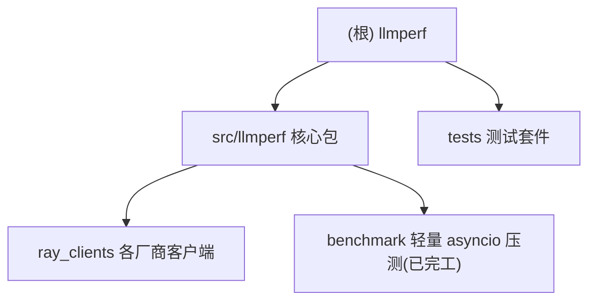

# CLAUDE.md — llmperf

## 项目愿景

`llmperf` 是一把量化 LLM API 性能与正确性的"压测尺"。它围绕一套统一的度量体系（首字延迟 TTFT、逐字延迟 Inter-Token Latency、端到端延迟 E2E、吞吐量、错误率）对不同厂商的 LLM 接口（OpenAI 兼容 / Anthropic / LiteLLM 支持的 100+ 家 / SageMaker / VertexAI）发起并发压测，并输出可对比的分位数统计报告；同时提供一个轻量的正确性校验工具（把数字转成英文单词再让模型转换回来，核对结果）。

核心设计理念是"一个插座配多种插头"：主循环/调度逻辑与具体厂商 API 的差异被严格隔离，新增一个厂商只需新增一个客户端实现，不改动任何既有代码（开放/封闭原则）。

## 架构总览

项目由两条并行的技术路线组成：

1. **成熟的 Ray 压测路线**（`token_benchmark_ray.py` + `llm_correctness.py` + `src/llmperf/`）：以 Ray Actor 作为并发原语，`RequestsLauncher` 通过 `ActorPool` 派发请求，多线程（`threading.Thread`）驱动多个 Actor 池并行工作，使用固定的 Llama 分词器保证跨模型 token 计数口径一致。这是当前**唯一可用、可跑通**的压测入口。
2. **轻量 asyncio 压测路线**（`src/llmperf/benchmark/`）：用 `asyncio` worker-pool 直接压 `litellm.acompletion()`，去掉 Ray/threading/pandas/transformers 等重脚手架，与 Ray 路线并存、零侵入。**已完工，并于 2026-07-15 完成一轮生产可用性硬化**（A1-A4 运行期正确性 + B1-B4 健壮性边界，41 个测试函数 / pytest 43 例全绿），`python -m llmperf.benchmark` 是可用的 CLI 入口。完整设计见 `docs/superpowers/specs/2026-06-28-litellm-benchmark-integration-design.md`（原始）与 `.../2026-07-15-benchmark-production-hardening-design.md`（硬化）、实施计划见对应 plan 文档、用户文档见 `docs/benchmark.md`。

两条路线共享同一套指标常量命名（`src/llmperf/common_metrics.py`），但**指标口径不完全一致**（尤其是 Inter-Token Latency 的计算公式在新路线里被有意修正，`metrics.py` 中已实际生效，见 `src/llmperf/benchmark/CLAUDE.md`），使用时注意不要跨路线直接对比数字。

此外，`--llm-api anthropic` 在最近一次提交中从"借道 LiteLLM"改为**原生 `/v1/messages` 客户端**（`src/llmperf/ray_clients/anthropic_messages_client.py`），去掉了中间层以获得更纯净的延迟测量，详见 `src/llmperf/ray_clients/CLAUDE.md`。

## 模块结构图



## 模块索引

| 路径 | 职责 | 语言 | 文档状态 |
|---|---|---|---|
| `src/llmperf` | 核心框架：`RequestConfig` 数据模型、指标常量、`LLMClient` 抽象接口、`RequestsLauncher` 调度、`utils.py` 工具函数；以及紧密耦合的两个入口脚本 `token_benchmark_ray.py`（性能压测）与 `llm_correctness.py`（正确性校验，位于仓库根目录） | Python | [详见](./src/llmperf/CLAUDE.md) |
| `src/llmperf/ray_clients` | 5 个 Ray Actor 客户端：OpenAI / Anthropic（原生）/ LiteLLM（万能兜底）/ SageMaker / VertexAI | Python | [详见](./src/llmperf/ray_clients/CLAUDE.md) |
| `src/llmperf/benchmark` | 轻量 asyncio 压测子模块，**已完工 + 生产可用性硬化**：prompt 采样、指标聚合、worker-pool 并发引擎、CLI 全部就绪，A/B 两簇 8 项硬化落地，41 个测试函数（pytest 43 例）全绿 | Python | [详见](./src/llmperf/benchmark/CLAUDE.md) |
| `tests` | pytest 单元测试，均为纯函数级测试（不连真实网络、不起 Ray） | Python | [详见](./tests/CLAUDE.md) |
| `docs/superpowers` | `benchmark` 子模块的设计规划文档（Markdown 计划书 + 设计规格），非代码 | Markdown | 不生成独立模块 CLAUDE.md，理由见下 |
| `.traces` | 运行期产生的 trace 日志（`.jsonl`/`.log`/`.html`） | - | 运行期产物，不生成文档 |
| `result_outputs` | 压测结果 JSON 落盘目录（`.gitignore` 中已忽略） | - | 运行期产物，不生成文档 |
| `.venv` | Python 虚拟环境（第三方依赖安装目录） | - | 不属于项目源码，完全跳过扫描 |

**未生成模块级文档的目录及理由：**
- `docs/superpowers/`：只包含 2 份 Markdown 设计文档（计划书 + 规格说明），不是代码模块，不存在"入口/接口/数据模型"等可归纳的模块化信息；其内容已在 `src/llmperf/benchmark/CLAUDE.md` 中作为背景引用。
- `.traces/`、`result_outputs/`：均为程序运行时产生的输出数据（trace 日志、压测结果 JSON），会随每次运行变化，不是可维护的源码资产，写文档没有长期价值。
- `.venv/`、`src/LLMPerf.egg-info/`、`.pytest_cache/`、`.ipynb_checkpoints/`：均为工具链自动生成的构建/缓存产物，非项目源码。
- `.claude/`：已存在 `.claude/FOR_thinkerisme.md`（面向用户的项目导读）、`settings.local.json`（本地权限配置）与 `index.json`（架构索引），均非架构文档范畴，不在本目录下生成 CLAUDE.md。

**关于任务说明中提到的 `litellm/benchmark/`：** 经实地核查，仓库中**不存在**名为 `litellm/benchmark/` 的目录。与之对应、且实际正在开发的新压测子模块位于 `src/llmperf/benchmark/`。判断这是任务描述中的路径笔误，已按实际路径归档文档。同理，`tests/test_litellm/` 目录在当前仓库中也不存在，`tests/` 下实际有 `test_anthropic_messages_client.py`、`test_benchmark_prompts.py`、`test_benchmark_metrics.py` 三个文件。

## 运行与开发

安装（editable 模式）：
```bash
pip install -e .
```
Python 版本约束：`>=3.8, <3.11`（`pyproject.toml`）。**这是一个硬约束**——`src/llmperf/benchmark/` 的开发计划中明确要求不得使用 3.10+ 语法（如 `list[str]`、`X | None`），必须用 `typing.List/Dict/Tuple/Optional`。

运行性能压测（以 OpenAI 兼容 API 为例）：
```bash
export OPENAI_API_KEY=secret_abcdefg
export OPENAI_API_BASE="https://api.endpoints.anyscale.com/v1"
python token_benchmark_ray.py --model "meta-llama/Llama-2-7b-chat-hf" \
  --mean-input-tokens 550 --stddev-input-tokens 150 \
  --mean-output-tokens 150 --stddev-output-tokens 10 \
  --max-num-completed-requests 2 --timeout 600 --num-concurrent-requests 1 \
  --results-dir "result_outputs" --llm-api openai --additional-sampling-params '{}'
```
其余 `--llm-api`（`anthropic` / `litellm` / `sagemaker` / `vertexai`）的用法与所需环境变量见根目录 `README.md`，各客户端的实现细节见 `src/llmperf/ray_clients/CLAUDE.md`。

运行正确性校验：
```bash
python llm_correctness.py --model "meta-llama/Llama-2-7b-chat-hf" \
  --max-num-completed-requests 150 --timeout 600 --num-concurrent-requests 10 \
  --results-dir "result_outputs"
```

代码格式化（提交前钩子）：
```bash
bash pre-commit.sh   # 内部执行 black . -q
```

## 测试策略

测试框架为 `pytest`（作为运行时依赖声明在 `pyproject.toml`，而非 dev 依赖；`requirements-dev.txt` 中只有 `black`）。运行全部测试：
```bash
python -m pytest tests/ -v
```
当前所有测试都是**纯函数级单测**：不依赖真实网络请求，也不启动 Ray runtime，用 `monkeypatch` 替换外部依赖（如 `litellm.token_counter`）。测试覆盖的是"协议解析/采样逻辑/指标聚合"这类容易出 bug、又难以对 Ray Actor 直接单测的部分——把易错逻辑抽成纯函数是本仓库反复出现的测试策略，详见 `tests/CLAUDE.md`。

**注意**：仓库未安装 `pytest-asyncio`，也没有配置 `asyncio_mode`；未来 `benchmark` 模块的异步测试约定是用 `asyncio.run()` 在普通同步 `def test_...()` 函数内驱动（零新增依赖）。

## 编码规范

- 格式化统一用 `black`（无自定义配置，走默认规则），提交前执行 `pre-commit.sh`。
- 类型注解在 `src/llmperf/benchmark/` 内**必须**使用 `typing.List/Dict/Tuple/Optional`，禁止 Python 3.10+ 新语法（因 `requires-python <3.11`）。
- 新增一个 LLM API 客户端的标准流程（README 中给出）：在 `ray_clients/` 下实现 `llmperf.ray_llm_client.LLMClient` 子类并用 `@ray.remote` 装饰，实现 `llm_request(request_config) -> (metrics, generated_text, request_config)`，然后在 `common.py::construct_clients()` 中加一个 `elif` 分支。
- 易错的协议解析逻辑（如 SSE 分帧）应抽成不依赖 Ray/网络的纯函数，便于用普通 pytest 断言（`anthropic_messages_client.py` 中的 `parse_data_line`/`extract_delta_text` 是范例）。
- 遵循"先写复现测试，再实现，跑到通过"（TDD）的开发方式，`docs/superpowers/plans/` 中的实施计划均以此模式编写（Red → Green → 格式化 → commit）。

## AI 使用指引

- 修改任意客户端前，先读 `src/llmperf/ray_llm_client.py` 理解统一接口契约（`llm_request` 必须返回三元组）。
- `src/llmperf/benchmark/` 已完工并硬化（原始 5 个 Task + 2026-07-15 硬化 8 项，41 个测试函数 / pytest 43 例）。继续扩展前先读设计规格 `docs/superpowers/specs/2026-06-28-litellm-benchmark-integration-design.md`（原始）与 `.../2026-07-15-benchmark-production-hardening-design.md`（硬化），理解已评审 6 轮的设计决策（尤其是 §4.2 的 worker-pool 并发模型，明确禁止用 `asyncio.gather` 批处理，因为历史上 Ray 版本因批处理语义踩过 #59 bug——这条约束在 `runner.py` 中已落地生效）。**注意本轮两处语义变更**：空流改判 `empty_response` 错误、单请求超时改为剩余预算，详见 `src/llmperf/benchmark/CLAUDE.md`。
- 涉及"指标口径"的改动（TTFT/ITL/吞吐 的计算公式）务必谨慎，两条压测路线口径已知不一致，改动前先确认改的是哪条路线。
- `.claude/FOR_thinkerisme.md` 是面向项目所有者的可读性导读文档，包含大量本次 Anthropic 客户端改造的背景故事和踩坑记录，与本文件（面向 AI 架构索引）互补，不要相互覆盖。

## 变更记录 (Changelog)

- 2026-07-15（benchmark 生产可用性硬化 A+B）：在 `src/llmperf/benchmark/` 上叠加 8 项硬化（SDD 子代理驱动，逐任务评审）。A 簇运行期正确性：A1 防御式 `extract_content`、A2 `_single_request` 异常绝不逃逸、A3 空流判 `empty_response`、A4 保留 `status_code==0`；B 簇健壮性边界：B1 `--metadata` 缺 `=` 友好报错、B2 单请求超时=剩余预算、B3 内建汇总键优先于 `--metadata`、B4 数值参数非正值以退出码 2 拒绝。测试 26 → 41 个函数（pytest 43 例）。同步更新根/子模块 CLAUDE.md、`docs/benchmark.md`、spec/plan 状态。设计规格 `docs/superpowers/specs/2026-07-15-benchmark-production-hardening-design.md`、计划 `.../plans/2026-07-15-benchmark-production-hardening.md`。**两处有意语义变更**（A3 空流、B2 超时），跨路线对比数字时注意。
- 2026-07-05（第三次扫描）：`src/llmperf/benchmark/` 完工——`runner.py`（asyncio worker-pool 并发引擎，修正原代码错误吞噬 bug）、`__main__.py`/`__init__.py`（CLI 入口）全部落地，加上 `docs/benchmark.md` 用户文档，5 个 Task、26 个测试全绿。同时修复了从 `utils.py` 移植时带过来的一个既有死循环 bug（`prompts.py::sample_prompt` 在 `stddev=0` 且 `mean` 小于基底前缀长度时会挂死，测试运行时才被发现）。计划文档 checkbox 已回填。
- 2026-07-05（第二次扫描）：核实发现 `src/llmperf/benchmark/metrics.py` 与 `tests/test_benchmark_metrics.py` 已实际存在（此前记录为"未创建"），更新架构总览、模块索引表与 AI 使用指引中的相关措辞；确认 `src/llmperf/ray_clients/CLAUDE.md`、`src/llmperf/benchmark/CLAUDE.md`、`tests/CLAUDE.md`、`.claude/index.json` 均已存在并已增量更新（详见各自文件的变更记录）。
- 2026-07-05（首次扫描）：首次执行自适应初始化架构扫描，生成根级与各模块 `CLAUDE.md`、`.claude/index.json`。
